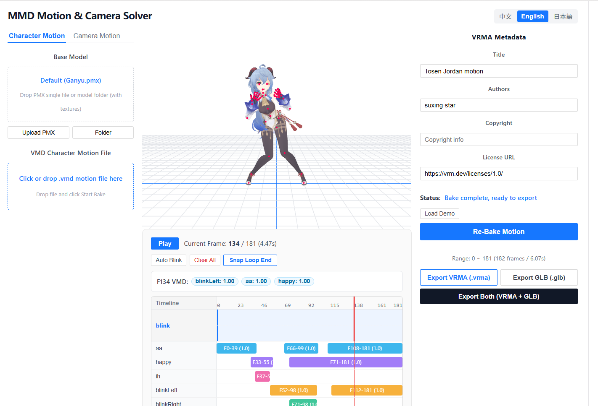

# MMD to Humanoid & VRMA Motion Converter

Convert MMD motion files (`.vmd`) into standard Humanoid GLB and VRMA animations directly in your browser.

## How it works

As we all know,directly retargeting MMD motion files onto standard humanoid rigs is difficult due to custom IK solvers, non-standard rest poses, and unique bone hierarchies.

This tool solves the issue in two simple steps:

1. **FK Baking**: Runs the PMX model and VMD animation in Three.js frame-by-frame to extract 3D world coordinates of key skeletal joints.
2. **Humanoid Retargeting**: Reconstructs bone rotations and root movement from the 3D coordinates, then exports the motion as GLB or VRMA.

## Usage & Preview


Test Page: https://suxuing-star.github.io/mmd-motion-baker-gltf/

```text
Step1: Drop the MMD model(optional) and VMD Motion into the left panel.
↓
Step2: Press the  `Start Bake` button in the right panel.
↓
Step3: Now you can edit the motion like video timeline.
↓
Step4: Press the Export GLB/VRMA Button in the right.
```




## Pipeline

```text
.pmx + .vmd
↓
1. Three.js FK Baking (Evaluate IK and record 3D joint coordinates)
↓
2. Humanoid Solver (Compute joint rotations and root offset)
↓
Output: .glb / .vrma
```

## Quick Start

```bash
git clone https://github.com/SUXUING-star/mmd-baker-gltf.git
cd mmd-baker-gltf
npm install
npm run dev
```

## Credits

Demo assets sourced from Aplaybox:

- Model: [Ganyu](https://www.aplaybox.com/details/model/xfyv7yIWHaxH)
